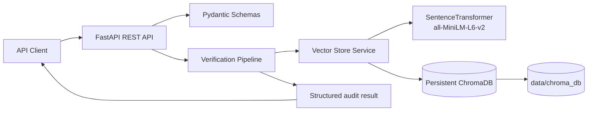
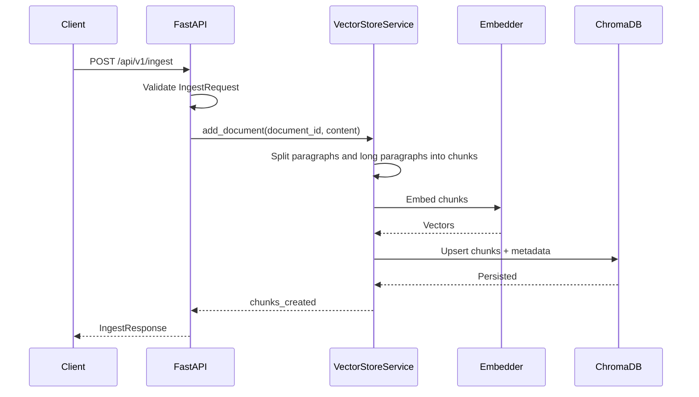
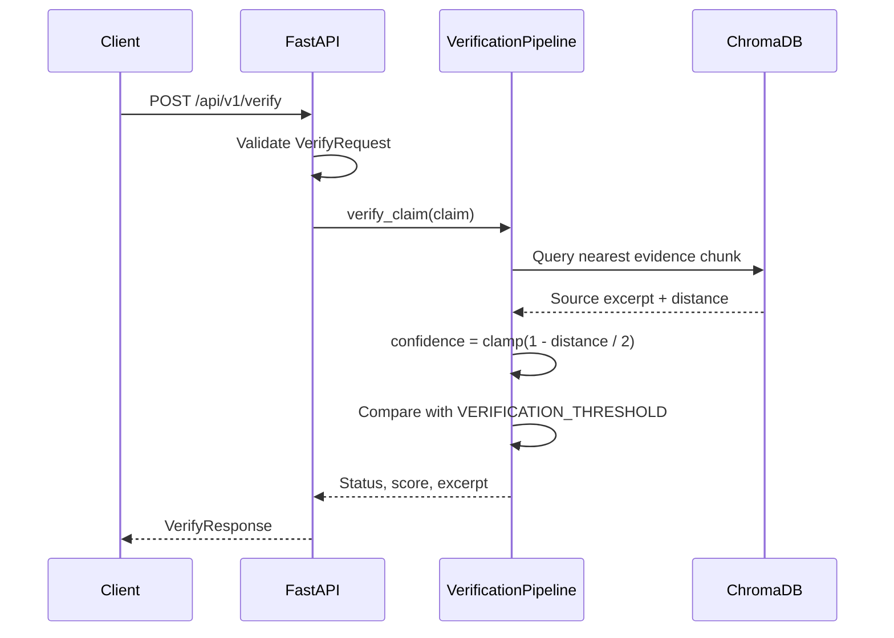
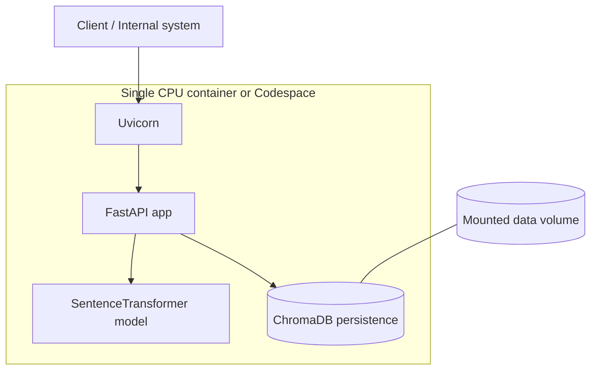

# Architecture Design

## 1. Goals and boundaries

The service provides a synchronous REST boundary for two operations:

1. **Ingest** trusted reference documents and persist searchable chunks.
2. **Verify** a claim by retrieving the nearest evidence and applying a
   deterministic confidence threshold.

The service does not generate unsupported explanations, call an external LLM,
or treat a missing evidence match as verified. ChromaDB and the embedding model
are local runtime dependencies, which keeps the deployment CPU-only and
portable to Codespaces.

## 2. Logical component design

**Responsibilities**

- `app.main`: HTTP routes, dependency wiring, and safe HTTP errors.
- `app.models.schemas`: input/output contract and enum validation.
- `app.services.vector_store`: chunking, embedding, upsert, and similarity
  retrieval.
- `app.services.pipeline`: distance-to-confidence conversion and threshold
  classification.
- `app.config`: environment-driven runtime configuration.

## 3. Ingest sequence

## 4. Verification sequence

## 5. Deployment design

The Docker image is stateless except for the mounted ChromaDB directory.
For production, mount `data/` on durable storage and place the API behind a
TLS-enabled gateway. Horizontal replicas should use a shared vector database
or a single-writer strategy because the default local store is process-local.

## 6. Data and reliability decisions

- Document chunks carry `doc_id` and `chunk_index` metadata.
- Re-ingesting the same document uses deterministic chunk IDs and `upsert`,
  making ingestion repeatable.
- An empty store returns `UNVERIFIED` with a zero score.
- Confidence is clamped to `[0, 1]`; the default verification threshold is
  `0.60` and can be overridden with `VERIFICATION_THRESHOLD`.
- API validation failures return `422`; indexing and retrieval failures return
  a generic `500` response without leaking internal implementation details.
